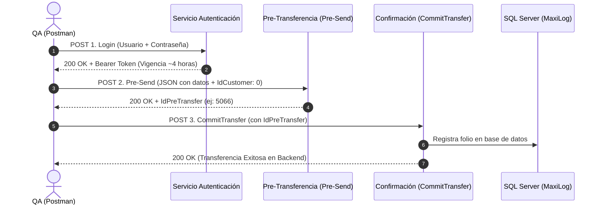

# 🚀 Manual y Tutorial Maestro de Postman para QA en Maxi LLC
**Autor:** José Antonio Hurtado (Toño) & Anty (Pette)  
**Propósito:** Guía de cabecera para pruebas de Backend, APIs y Pruebas de Carga en Hermes 2 / Chronos  
**Fecha:** Noviembre 2026  

---

## 📑 Índice de Contenidos
1. **Fundamentos Esenciales de APIs y Postman**
2. **La Arquitectura del API de Transferencias en Maxi (El Flujo de Ignacio)**
3. **Paso a Paso: Los 3 Endpoints Vitales (`Login`, `Pre-Send`, `CommitTransfer`)**
4. **Scripts y Variables Dinámicas (El secreto de `IdCustomer: 0`)**
5. **Pruebas de Carga y Estrés (Collection Runner & Performance)**
6. **Validación Cruzada con SQL Server (`MaxiLog`) y Hermes**
7. **Resolución de Errores Comunes (Troubleshooting)**

---

## 🧠 1. Fundamentos Esenciales de APIs y Postman

### ¿Qué es una API y qué hace Postman?
Una **API (Application Programming Interface)** es el puente que permite a la pantalla de Hermes comunicarse con los servidores y bases de datos de Maxi.
* **El Frontend (Hermes Web):** Es la interfaz visual con botones y carruseles.
* **El Backend (Las APIs):** Es donde vive la lógica de negocio, las comisiones, las reglas OFAC y la base de datos.
* **Postman:** Es la herramienta que nos permite **comunicarnos directamente con el Backend sin pasar por la pantalla web**, ahorrando tiempo y permitiendo enviar cientos de transacciones por segundo.

### Anatomía de una Petición HTTP:
| Componente | Explicación | Ejemplo en Maxi |
| :--- | :--- | :--- |
| **Método HTTP** | La acción que queremos realizar. | **`POST`** (Crear/Enviar datos), **`GET`** (Consultar). |
| **Endpoint (URL)** | La dirección web del servicio. | `https://test-hermes-api-lambdas.maxilabs.net/api/Transfer/...` |
| **Headers** | Metadatos de la petición. | `Content-Type: application/json`, `Authorization: Bearer <token>` |
| **Body (Cuerpo)** | La información enviada en formato JSON. | Datos del cliente, monto (`$191.00`), beneficiario, comisiones. |
| **Status Code** | La respuesta del servidor. | `200 OK` (Éxito), `400` (Datos inválidos), `401/403` (No autorizado), `500` (Error interno del servidor). |

---

## 🔄 2. La Arquitectura del API de Transferencias en Maxi

En la sesión de capacitación, Ignacio explicó que una transferencia no se hace en una sola llamada; se divide en **3 fases encadenadas**:



---

## 🛠️ 3. Paso a Paso: Los 3 Endpoints Vitales

### Endpoint 1: `POST 1. Login`
* **Objetivo:** Autenticarse contra el servicio y obtener un pase de acceso (**Bearer Token**).
* **Body:**
  ```json
  {
    "user": "tu_usuario_api",
    "password": "tu_password_api"
  }
  ```
* **Respuesta Exitosa:** `200 OK` devolviendo un token alfanumérico largo.
* **Tip de Experto:** Este token dura aproximadamente **4 horas**. No necesitas correr el Login cada vez que hagas un envío, a menos que caduque.

---

### Endpoint 2: `POST 2. Pre-Send`
* **Objetivo:** Preparar la cotización, calcular tarifas, tipo de cambio y validar datos preliminares.
* **Body (Extraído de `Request1.json` en `MaxiLog`):**
  Aquí se inyectan los datos de la transferencia:
  ```json
  {
    "PrefixDialingCode": "04",
    "OFACMatch": { "GeneralStatus": "NoMatch" },
    "TTransferDescription": {
      "IdPaymentType": 1,
      "IdPayerConfig": 198600,
      "IdCountry": 23,
      "IdAgent": 1242,
      "TransferAmount": 191.0,
      "TotalFeeDollar": 10.0,
      "TotalOperationAmount": 201.0,
      "IdCustomer": 0,
      "IdBeneficiary": 0
    }
  }
  ```
* **Respuesta Exitosa:** `200 OK` devolviendo el campo clave: **`"IdPreTransfer": 5066`** (este número cambia en cada envío).

---

### Endpoint 3: `POST 3. CommitTransfer`
* **Objetivo:** Sellar la transacción y emitir el folio oficial en el sistema.
* **Body:** Recibe el ID de la pre-transferencia generado en el paso anterior:
  ```json
  {
    "IdPreTransfer": 5066
  }
  ```
* **Respuesta Exitosa:** `200 OK`. Al recibir este código, la remesa ha quedado registrada exactamente igual que si la hubieras hecho desde Hermes 2.

---

## ⚡ 4. Scripts y Variables Dinámicas: El Secreto de `IdCustomer: 0`

### ¿Por qué poner `IdCustomer: 0` e `IdBeneficiary: 0`?
Maxi tiene reglas de negocio estrictas para prevenir el lavado de dinero y sobregiros:
* Si usas el ID de un cliente existente (`IdCustomer: 12345`), llegará un momento (al envío 5 o 10) en que el sistema lo **bloqueará por superar el límite diario de envíos permitidos**.
* **La Solución de Ignacio:** Si enviamos `"IdCustomer": 0` e `"IdBeneficiary": 0`, la API interpreta que es un **cliente y beneficiario nuevo**, evitando topes y permitiendo generar cientos de transacciones continuas.

### Generador de Nombres Aleatorios (Pre-request Script):
En la pestaña **`Scripts -> Pre-request`** de la petición `Pre-Send`, el equipo usa un script en JavaScript que toma nombres y apellidos de una lista aleatoria:
```javascript
const nombres = ["Nathan", "Wagner", "Zimmer", "Alejandro", "Lucia", "Susana"];
const apellidos = ["Garcia", "Perez", "Paterson", "Lopez", "Morales"];

// Seleccionar uno al azar
const randomNombre = nombres[Math.floor(Math.random() * nombres.length)];
const randomApellido = apellidos[Math.floor(Math.random() * apellidos.length)];

// Inyectar en las variables de Postman
pm.environment.set("customerName", randomNombre);
pm.environment.set("customerLastName", randomApellido);
```

---

## 📊 5. Pruebas de Carga y Estrés (Collection Runner & Performance)

Cuando necesites probar el comportamiento de los servidores ante alto volumen:

### A) Modo Iteraciones (Secuencial con Delay):
1. En la colección, haz clic en los tres puntos `...` y selecciona **`Run collection`**.
2. **Iterations:** Elige la cantidad (ej: `100`).
3. **Delay (CRÍTICO):** Configura **`1500 ms` o `2000 ms`** (1.5 a 2 segundos).
   * *¿Por qué?* Si no pones delay, las peticiones salen a milisegundos de diferencia y el backend de base de datos puede lanzar errores de `Timeout` o `Deadlock`.

### B) Modo Performance (Concurrencia Real):
1. En el Runner, cambia la pestaña a **`Performance`**.
2. **Virtual Users (VUs):** Configura `20` usuarios virtuales.
3. **Duration:** Configura `2 minutes` (o el tiempo acordado con el equipo).
4. Dale clic al botón naranja **`Start run`**. Postman graficará en tiempo real:
   * Tiempos de respuesta (latencia en ms).
   * Tasa de error (debe mantenerse en 0%).
   * Rendimiento por segundo (Throughput / Requests per second).

> ⚠️ **Regla de Convivencia QA:** Avisar siempre en Slack antes de correr una prueba de estrés para que los compañeros sepan por qué el ambiente de Test podría sentirse lento.

---

## 🔍 6. Validación Cruzada con SQL Server (`MaxiLog`)

Para comprobar que tus pruebas en Postman se reflejaron correctamente en el sistema:
1. Abre **SQL Server Management Studio (SSMS)** conectado a `192.168.5.10`.
2. Selecciona la base de datos **`MaxiLog`**.
3. Ejecuta una consulta sobre las transacciones recientes:
   ```sql
   SELECT TOP 10 
       IdTransfer, 
       IdAgent, 
       CustomerName, 
       BeneficiaryName, 
       Amount, 
       DateOfTransfer 
   FROM Transfers WITH (NOLOCK)
   WHERE IdAgent = 1242
   ORDER BY DateOfTransfer DESC;
   ```
4. Comprueba que el `CustomerName` generado aleatoriamente por Postman aparezca en el primer renglón con estatus correcto.

---

## 🚨 7. Resolución de Errores Comunes (Troubleshooting)

| Código / Error | Causa Raíz | Solución |
| :--- | :--- | :--- |
| **`401 Unauthorized`** | El Bearer Token expiró (pasaron más de 4 horas). | Vuelve a ejecutar la petición `POST 1. Login` para renovar el token. |
| **`400 Bad Request`** | Faltan campos obligatorios en el JSON o el tipo de dato es incorrecto. | Revisa que ningún campo numérico vaya entre comillas o vacío. |
| **`403 Forbidden`** | El usuario no tiene permisos sobre la agencia o el país destino. | Verifica en el JSON que `IdAgent` pertenezca a tu catálogo habilitado. |
| **`504 Gateway Timeout`** | El servidor tardó más de 30 segundos en responder durante una prueba de carga. | Aumenta el `Delay` en el Collection Runner a `2500 ms`. |
